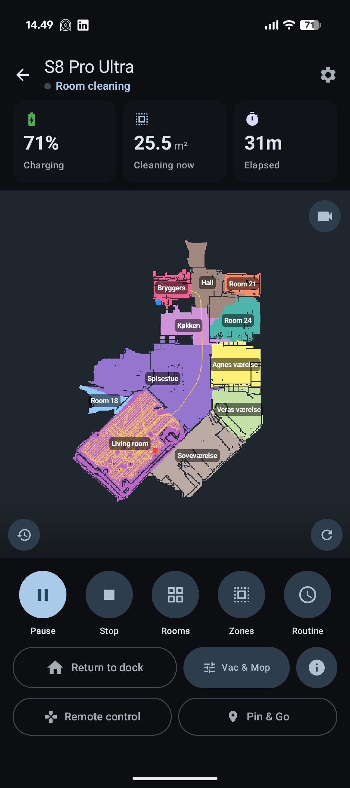
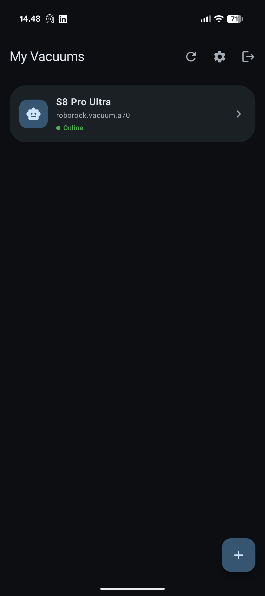
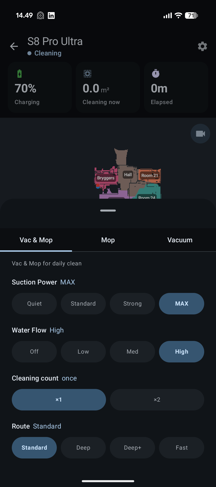
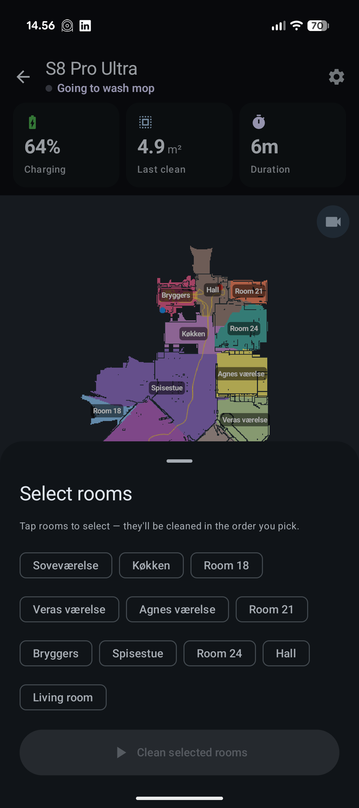
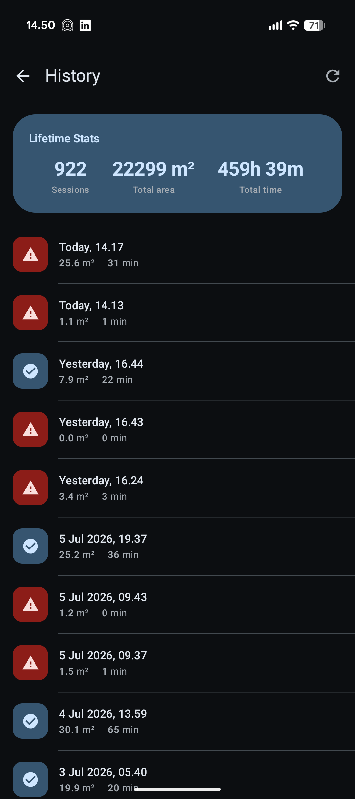
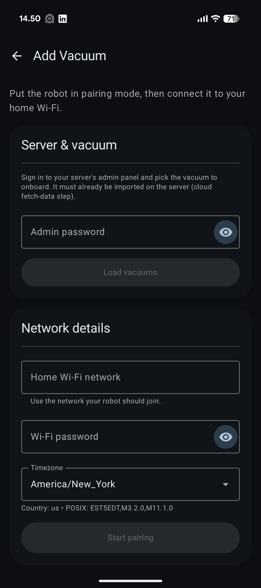
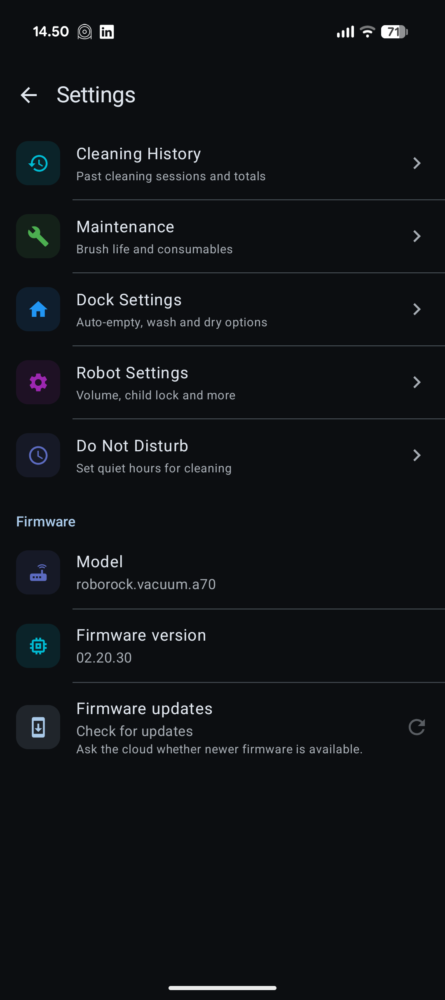
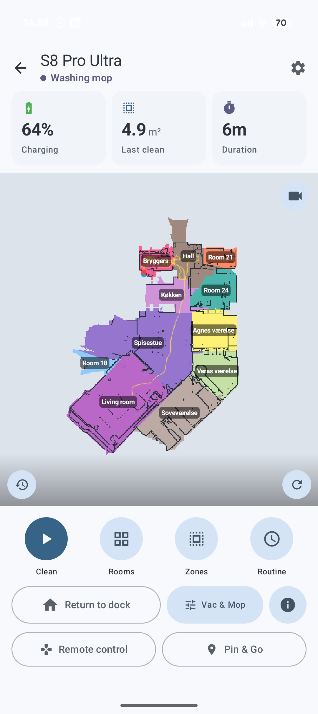

# LocalRock

**A local-network client for Roborock vacuums — control your robot without the Roborock cloud.**

<p align="center">
  <a href="https://github.com/DonSidro/LocalRock/releases/latest"></a>
  <a href="./LICENSE"></a>
  
  <a href="https://kotlinlang.org/docs/multiplatform.html"></a>
  <a href="https://www.jetbrains.com/compose-multiplatform/"></a>
  <br>
  <a href="https://github.com/DonSidro/LocalRock/stargazers"></a>
  <a href="https://github.com/DonSidro/LocalRock/issues"></a>
  <a href="https://discord.gg/MJDZm9zmjY"></a>
</p>

LocalRock is a [Kotlin Multiplatform](https://kotlinlang.org/docs/multiplatform.html) / [Compose Multiplatform](https://www.jetbrains.com/compose-multiplatform/) app (Android + iOS) that talks to a privately‑hosted [local_roborock_server](https://github.com/Python-roborock/local_roborock_server) instead of Roborock's cloud. Onboard and control your vacuum and edit its maps, entirely on your own network.

<p align="center">
  
</p>

<table align="center"><tr>
  <td valign="middle">
    <a href="https://play.google.com/store/apps/details?id=com.kodraliu.localrock">
      
    </a>
  </td>
  <td valign="middle">
    <a href="https://apps.apple.com/dk/app/localrock/id6788538720">
      
    </a>
  </td>
</tr></table>

> [!IMPORTANT]
> **Not affiliated with, endorsed by, or sponsored by Roborock.** All product names and trademarks are the property of their respective owners. This is an independent, community project.

---

## Table of contents

- [Why LocalRock](#why-localrock)
- [Features](#features)
  - [Not available](#not-available)
- [Screenshots](#screenshots)
- [How it works](#how-it-works)
  - [Camera live view](#camera-live-view)
- [Requirements](#requirements)
- [Getting started](#getting-started)
  - [1. Run the local server](#1-run-the-local-server)
  - [2. Build the app](#2-build-the-app)
  - [3. First‑run setup](#3-first-run-setup)
- [Project structure](#project-structure)
- [Tech stack](#tech-stack)
- [Platform status](#platform-status)
- [Building from source](#building-from-source)
- [Troubleshooting](#troubleshooting)
- [Privacy & security](#privacy--security)
- [Community](#community)
- [Support the project](#support-the-project)
- [Contributing](#contributing)
- [License](#license)

---

## Why LocalRock

The official Roborock app routes every command through Roborock's servers. LocalRock is for people who want to keep their robot on the local network:

- **No Roborock cloud dependency** — the app talks only to *your* server.
- **No analytics, no remote logging, no auto‑update, no account creation.**
- **Onboard new vacuums straight from the phone** — no laptop or CLI needed.
- **Open source**, so you can see exactly what it does with your data.

The app implements the Roborock protocol (Hawk‑signed REST + MQTT‑over‑TLS RPC + the V1 message envelope) against the local server's cloud‑emulation API.

---

## Features

- **Live map** — real‑time robot map with zoom/pan, room labels, cleaning path, no‑go zones, walls and carpets
- **Full cleaning control** — start / pause / stop / dock, room and zone cleaning
- **Cleaning modes** — Vac & Mop, Mop or Vacuum, with suction power, water flow, route and cleaning count; **SmartPlan** on robots that support it
- **Per‑room settings** — give each room its own suction, water and route for one run
- **Room cleaning** — pick rooms in the order they should be cleaned, with real names pulled from your home data, and set a default cleaning order for a full clean
- **Pin & Go** — send the robot to a point on the map
- **Remote control** — manually drive the vacuum
- **Map editor** — draw no‑go zones, invisible walls, carpets (including round ones) and thresholds; pick a room type or give a room a custom name; split and merge rooms; set floor types
- **Map management** — rename and delete maps, and send the robot out to map the home again (for example after moving the dock)
- **Multi‑level homes** — keep a map per floor, switch with the picker on the map, or let the robot recognise the floor by itself
- **Schedule** — recurring cleans at a set time and on chosen days
- **Dock controls & settings** — empty, wash and dry, tank and dust‑bag status, empty the robot's built‑in water tank through the dock, and the dock's own settings (wash mode, mop wash frequency, auto‑empty), offered per model
- **Robot settings** — volume, child lock, status LED, carpet mode and Do Not Disturb
- **Robot alerts** — optional notifications when a robot gets stuck, finishes cleaning, or its dock needs attention; on Android a background watch keeps them coming while the app is closed and can show cleaning progress
- **Status & consumables** — battery, state, cleaning stats, filter/brush life
- **Cleaning history** — past sessions and lifetime totals
- **On‑phone onboarding** — provision a brand‑new vacuum over Wi‑Fi from the app
- **Light / dark / system theme**
- **What's new** — release notes shown once in the app after an update (they ship inside the app; nothing is fetched)

### Not available

- ~~**Camera live view**~~ — **does not work on a local‑only setup, and the button is hidden in the app.** The robot only allows a camera preview after Roborock's **cloud** has authorised remote viewing, and that authorisation cannot be set from the local network. Making it work without the cloud needs **changes in [`local_roborock_server`](https://github.com/Python-roborock/local_roborock_server)**. See [Camera live view](#camera-live-view) for details.
- ~~**Firmware update check**~~ — hidden in the app. It needs the server to proxy Roborock's OTA endpoint; without that there is no cloud to ask.

---

## Screenshots

The app follows the system theme by default; light and dark can be forced in settings.

| Map & control | Device list | Cleaning modes | Room selection |
| :---: | :---: | :---: | :---: |
|  |  |  |  |

| More actions | Map editor | Maps & floors | Dock & care |
| :---: | :---: | :---: | :---: |
|  |  |  |  |

| Cleaning history | Add vacuum | Robot settings |
| :---: | :---: | :---: |
|  |  |  |

Light theme:

<p align="center">
  
</p>

---

## How it works

```
┌──────────────┐      HTTPS (REST, Hawk-signed)      ┌───────────────────────┐      ┌──────────┐
│   LocalRock  │ ──────────────────────────────────▶ │  local_roborock_server │      │ Roborock │
│ (Android/iOS)│ ◀────────── MQTT over TLS ────────▶ │  (cloud emulation +    │ ◀──▶ │  vacuum  │
│              │            (V1 RPC frames)          │   MQTT broker/bridge)  │ MQTT │          │
└──────────────┘                                     └───────────────────────┘      └──────────┘
```

- **REST** — login, home data, device list. Requests are Hawk‑signed with credentials issued by the server.
- **MQTT over TLS** — the robot and the app both connect to the server's MQTT broker; the server bridges messages between them. Commands are Roborock **V1 protocol** frames (protobuf/JSON envelope). Map edits and map management run over this same channel.

The app is **local‑only by design**: there is no Roborock‑cloud login, no server discovery, and no telemetry. The server URL is configured manually.

### Camera live view

> [!WARNING]
> ~~**Camera live view**~~ **is not available.** It needs Roborock's **cloud** to work, and **server changes** before it can work locally.

The code is in the repository (WebRTC signaled over the MQTT dps‑101/102 channel, PIN‑protected), but the entry point is hidden in the app:

- The robot refuses to start a preview until **remote viewing has been authorised by Roborock's cloud**. That authorisation is a protected flag on the robot: it cannot be written over the local protocol, and it is reset when the robot is bound to the local server.
- Working without the cloud therefore needs **changes in [`local_roborock_server`](https://github.com/Python-roborock/local_roborock_server)** so the server can grant that authorisation in the cloud's place. Until then there is nothing the app can do on its own.
- The WebRTC flow itself has run end to end once on an S8 Pro Ultra whose camera had been enabled through the official app, so the remaining gap is the authorisation, not the video path.

---

## Requirements

- A running instance of [`local_roborock_server`](https://github.com/Python-roborock/local_roborock_server) reachable over HTTPS on your network, with your vacuum(s) imported into its inventory.
- The server's TLS certificate trusted on your device (install its CA if it's self‑signed — see [Troubleshooting](#troubleshooting)).
- **Android 7.0 (API 24)** or newer.
- **iOS** build requires macOS + Xcode (see [Platform status](#platform-status)).

---

## Getting started

### 1. Run the local server

Follow the setup instructions for [`local_roborock_server`](https://github.com/Python-roborock/local_roborock_server). Note:

- Point the app at the **server root** (e.g. `https://your-host:555`), **not** the `/admin` panel.
- Make sure your vacuum is imported into the server's inventory and connected to its MQTT broker.

### 2. Build the app

**Android:**

```shell
# macOS / Linux
./gradlew :composeApp:assembleDebug

# Windows
.\gradlew.bat :composeApp:assembleDebug
```

The APK lands in `composeApp/build/outputs/apk/debug/`. Install it, or run directly from Android Studio.

**iOS:** open `iosApp/` in Xcode and run (requires macOS — see [Platform status](#platform-status)).

### 3. First‑run setup

On first launch the app walks you through:

1. **Welcome / intro** screen.
2. **Server URL** — enter your server's HTTPS root URL.
3. **Login** — enter the email + login code from your **server setup** (these are your local‑server credentials, not real Roborock credentials).
4. **Device list** — your vacuums appear; tap one to open its map and controls.

To add a new, un‑provisioned vacuum, use the **Add vacuum** flow, which provisions the robot over Wi‑Fi and registers it with the server.

---

## Project structure

Single‑module Compose Multiplatform project:

```
composeApp/src/
├─ commonMain/          # shared Kotlin (UI + logic) for all targets
│  └─ kotlin/com/kodraliu/localrock/
│     ├─ shared/        # non-UI core
│     │  ├─ auth/       # login + credential model
│     │  ├─ device/     # home/device data & repository
│     │  ├─ model/      # server API data classes
│     │  ├─ vacuum/     # VacuumRepository, Commands, map parsing + map edit commands
│     │  ├─ mqtt/       # self-healing MQTT client + transport abstraction
│     │  ├─ notify/     # robot alerts: event detection, background watch, notifier
│     │  ├─ messages/   # in-app messages and errors
│     │  ├─ settings/   # app settings
│     │  ├─ onboarding/ # phone Wi-Fi provisioning + admin session API
│     │  ├─ crypto/     # RSA / AES / HMAC / MD5 helpers
│     │  ├─ protocol/   # Roborock V1 message envelope
│     │  ├─ http/       # Ktor client factories + Hawk auth
│     │  ├─ demo/       # sample data for the demo login
│     │  ├─ platform/   # small platform hooks (donation links)
│     │  └─ webrtc/     # camera peer/video (expect/actual, currently unused)
│     └─ ui/            # Compose screens: devices, vacuum (map, editor,
│                       #   schedule), settings, login, intro, onboarding,
│                       #   whatsnew, navigation
├─ androidMain/         # Android actuals (OkHttp, Paho MQTT, libwebrtc)
└─ iosMain/             # iOS actuals (Darwin, Swift-bridged MQTT/WebRTC/RSA)

iosApp/                 # SwiftUI entry point + native bridges
tests/                  # protocol/contract fixtures & tests
```

---

## Tech stack

| Area | Choice |
| --- | --- |
| Language | Kotlin 2.3.x |
| UI | Compose Multiplatform 1.10.x, Material 3 |
| Navigation | AndroidX Navigation‑Compose (typed `@Serializable` routes) |
| Networking | Ktor 3.x (OkHttp on Android, Darwin on iOS) |
| Serialization | kotlinx.serialization (JSON + Protobuf) |
| MQTT | Eclipse Paho on Android; CocoaMQTT (Swift bridge) on iOS |
| Crypto | KotlinCrypto (MD5, HMAC‑SHA2) + platform RSA |
| WebRTC (camera, not enabled) | `io.getstream:stream-webrtc-android` (Android); `WebRTC.framework` (iOS) |
| Settings/persistence | multiplatform‑settings |
| Min SDK / Target | Android 24 / 36 |

---

## Platform status

| Feature | Android | iOS |
| --- | :---: | :---: |
| Core control, map, rooms | Yes | Yes |
| Map editor, map management, multi‑level maps | Yes | Yes |
| MQTT over TLS | Yes (Eclipse Paho) | Yes (CocoaMQTT bridge) |
| ~~Camera live view (WebRTC)~~ | Hidden — needs cloud / server changes | Hidden — needs cloud / server changes |
| RSA (onboarding crypto) | Yes | Yes |
| Phone Wi‑Fi pairing (Add vacuum) | Yes | Yes |

**Map editor note:** saving zones, walls, carpets and thresholds is currently limited to robots with a **single saved map**; on a multi‑level robot those tools are disabled and the editor says so. Room edits and map management are not affected. No‑mop zones are not editable yet.

**Camera live view note:** not available on either platform — see [Camera live view](#camera-live-view).

**iOS note:** Kotlin/Native iOS targets must be built on macOS. The iOS MQTT and WebRTC integrations rely on Swift Package Manager dependencies ([CocoaMQTT](https://github.com/emqx/CocoaMQTT), [WebRTC](https://github.com/stasel/WebRTC)) that must be added to the `iosApp` Xcode target, and the Swift bridge files (`CocoaMqttTransport.swift`, `WebRtcPeer.swift`, `VacuumPairing.swift`) added to the target. Pass `nil` for the WebRTC factory to ship without live view, or `nil` for the pairing factory to hide the "add vacuum" flow. iOS uses a custom bundle identifier that needs signing/provisioning selected in Xcode.

**iOS pairing entitlement:** joining the robot's access point uses `NEHotspotConfiguration`, which needs the **Hotspot Configuration** capability. It is declared in `iosApp/iosApp.entitlements` and wired into the target, but it only signs once the capability is enabled for the App ID in the Apple Developer portal (Certificates, Identifiers & Profiles → your App ID → Hotspot Configuration). Without it the app fails to sign; with it, the UDP handshake also triggers the local-network prompt backed by `NSLocalNetworkUsageDescription`.

---

## Building from source

**Prerequisites:** JDK 17+, Android SDK, and (for iOS) macOS + Xcode.

```shell
git clone <your-fork-url>
cd LocalRock

# Android debug build
./gradlew :composeApp:assembleDebug

# Run unit tests
./gradlew :composeApp:testDebugUnitTest
```

`gradle.properties` sets `-Xss64m` on the Gradle daemon to avoid a deep‑recursion `StackOverflowError` in Gradle's free‑list allocator on some machines — keep that flag.

---

## Troubleshooting

**"No data" / everything times out on the vacuum screen**
- The app connects to the server's MQTT broker but receives nothing. Confirm the robot is connected to the *server's* broker and the server bridge is running.
- Credentials issued by the server age out. If it was working and stopped, re‑login to refresh the session.

**TLS / can't connect to server**
- If the server uses a self‑signed certificate, install its CA on the device. On iOS the app performs a real trust evaluation — the CA must be installed and trusted.
- Use the server **root** URL (`https://host:555`), not `/admin`.

**Can't connect behind a reverse proxy (Traefik and others)**
- A proxy with strict SNI picks its certificate by the host name in the TLS handshake. The app sends it on Android since 1.3.0 and on iOS from the next release; on an older build, update. Traefik logs `No certificate found for domain: ""` when it is missing.

**Add vacuum can't reach the robot**
- Turn off any VPN on the phone while pairing. The phone has to join the vacuum's own Wi‑Fi, and a VPN can route that traffic away from it.

**Two devices, one works and the other times out**
- Each install generates a unique client id, so multiple devices should coexist. If you built an older revision, update — this was fixed by folding a per‑install id into the MQTT client id.

**The map editor's zone tools are greyed out**
- Saving zones, walls, carpets and thresholds is only supported on robots with a single saved map for now.

**There is no camera button**
- Expected — see [Camera live view](#camera-live-view).

**Room names show as "Room 26"**
- Real names come from your server's `get_home_data`. If the server doesn't return room names, the map falls back to segment ids.

---

## Privacy & security

- **No cloud, no analytics, no remote logging.** The app talks only to the server you configure.
- Auth tokens are excluded from Android cloud/device‑to‑device backup (`allowBackup=false` + backup rules).
- HTTP request/response logging is disabled in release builds (bodies carry secrets).
- Secrets are kept out of logs.

---

## Community

Join the [LocalRock Discord](https://discord.gg/MJDZm9zmjY) for help with setup, questions, and release announcements. Bug reports and feature requests are best filed as [GitHub issues](https://github.com/DonSidro/LocalRock/issues) so they can be tracked.

---

## Support the project

LocalRock is free, open source, and built in my spare time. There's no cloud, no subscriptions, and no analytics — just an app that does one thing for people who want their vacuum to stay on the local network.

If it's useful to you and you'd like to help keep it maintained, a small donation goes a long way and is genuinely appreciated. It's never required — the app is and will stay free.

- **GitHub Sponsors** — [github.com/sponsors/donsidro](https://github.com/sponsors/donsidro)
- **Buy Me a Coffee** — [buymeacoffee.com/sidon](https://www.buymeacoffee.com/sidon)

Not able to donate? Starring the repo, filing good bug reports, and contributing fixes help just as much.

---

## Contributing

Contributions are welcome! Please open an issue to discuss substantial changes first, or bring them up on [Discord](https://discord.gg/MJDZm9zmjY). When submitting a PR:

- Keep the app **local‑only** — no code paths that depend on the real Roborock cloud.
- Follow the existing architecture (single `commonMain` core, `StateFlow` view models, manual DI via `AppContainer`, expect/actual for platform bits).
- Run `./gradlew :composeApp:testDebugUnitTest` before submitting.

---

## License

Released under the [MIT License](./LICENSE) — © 2026 Sidon Kodraliu. You're free to use, modify, and distribute it; the software is provided "as is", without warranty.

---

## Acknowledgements

- [`local_roborock_server`](https://github.com/Python-roborock/local_roborock_server) — the self‑hosted backend this client targets.
- [`python-roborock`](https://github.com/Python-roborock/python-roborock) — reference for the Roborock protocol.
- [go2rtc](https://github.com/AlexxIT/go2rtc) — reference for the camera WebRTC‑over‑MQTT signaling (the camera code is in the tree but not enabled).

> LocalRock is an independent project and is **not affiliated with Roborock**.
